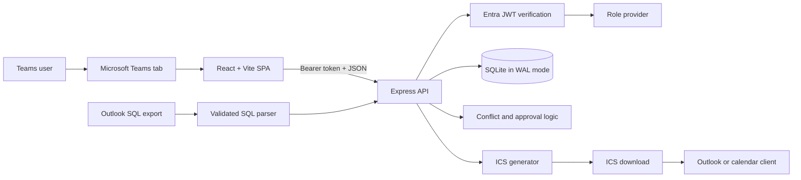
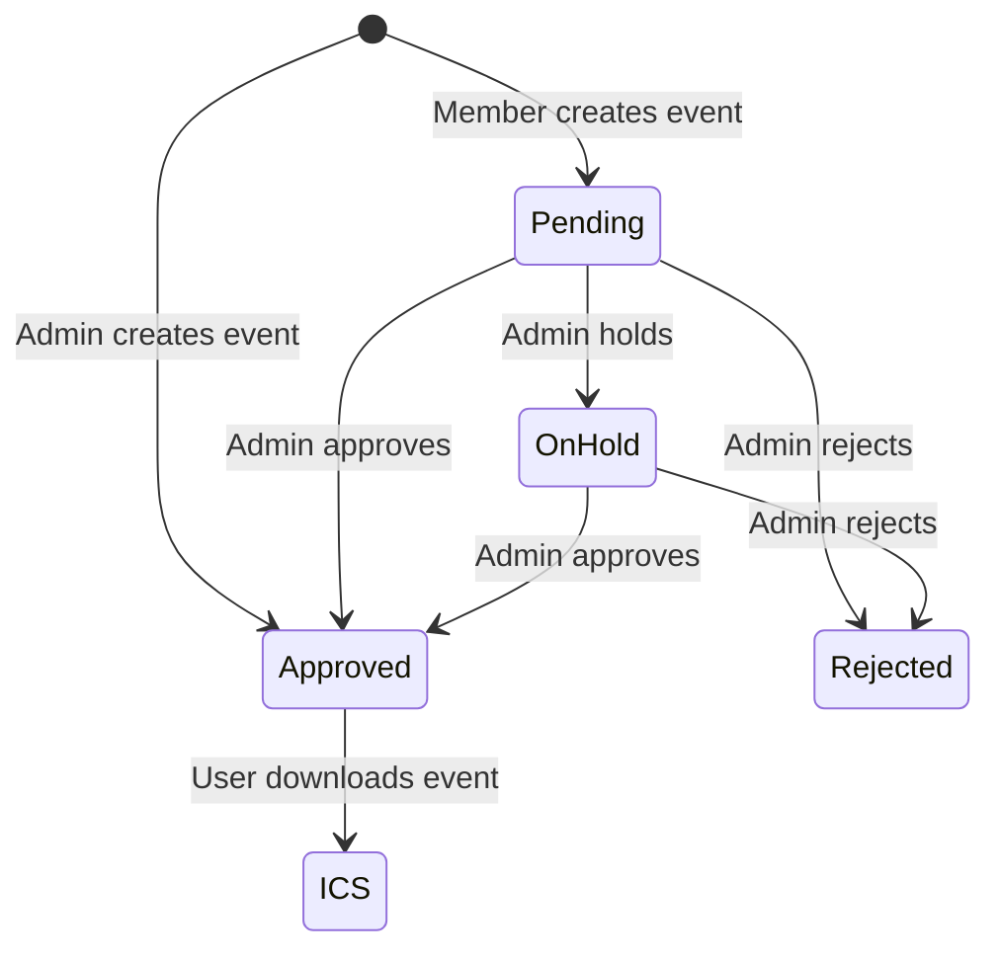

# Architecture

Intern Calendar is a single Node.js application that serves a React Teams tab and an Express JSON API. Shared TypeScript types keep the browser and server contracts aligned, while SQLite provides local persistence.

## Runtime components

| Component | Implementation | Responsibility |
| --- | --- | --- |
| Teams host | Teams static tab and `@microsoft/teams-js` | Loads `/tabs/home`, supplies host context, and participates in authentication |
| Frontend | React, TypeScript, Vite | Month/week views, event dialogs, approval side panel, import, role management, and messages |
| Application host | `@microsoft/teams.apps` with `ExpressAdapter` | Starts the Node server and integrates Teams development tooling |
| API | Express route handlers | Authentication, authorization, validation, event transitions, and JSON contracts |
| Persistence | Node.js `DatabaseSync` SQLite | Users, events, assignees, categories, decisions, and audit logs |
| Shared domain | TypeScript types and date utilities | Roles, statuses, categories, request types, and local-date handling |
| Calendar export | Server-side ICS generator | Produces all-day or timed iCalendar downloads |

## Frontend composition

`App.tsx` owns the main React state and coordinates these views:

- `MonthCalendar` and `WeekGrid` for calendar navigation
- `EventDialog` for create and edit operations
- `SidePanel` for the administrator approval queue
- `UserManagement` for role changes
- `ImportDialog` for Outlook SQL migration
- `MessageBar` for operation feedback

The browser API client uses `fetch` and refreshes local state after mutations. There is no WebSocket or offline synchronization layer.

## API surface

All routes require authentication except the ICS download.

| Method and route | Purpose |
| --- | --- |
| `GET /api/me` | Return the current user, events, users, and audit data needed to boot the UI |
| `GET /api/users` | List the team roster |
| `POST /api/events` | Validate and create an event |
| `PUT /api/events/:id` | Update an authorized event |
| `DELETE /api/events/:id` | Delete an authorized event |
| `POST /api/decisions` | Approve, hold, or reject an event as an administrator |
| `POST /api/users/:id/role` | Change a user role as an administrator |
| `GET /api/ics/:eventId` | Download a single event as `.ics` without authentication |

## Data model

SQLite is stored in `data/intern-calendar.db` by default and uses write-ahead logging. The schema contains:

- `users`: identity, email, display name, role, and UI color
- `events`: content, category, local dates/times, status, requester, and organizer data
- `assignees`: many-to-many event assignments
- `decisions`: administrator actions and reasons
- `audit_logs`: recorded access and mutations
- `categories`: supported event categories

Prepared statements bind all database values. SQLite is appropriate for the current small team deployment, but its single-writer model and local file storage require deliberate backup and scaling plans.

## Authentication and authorization

Production mode is selected when both `ENTRA_TENANT_ID` and `ENTRA_CLIENT_ID` are configured. The API verifies bearer JWTs with Entra's remote JWKS and resolves the application role from the database.

Without those variables, the server enters development mode and allows local identity switching. Development mode must not be exposed as a production deployment.

## Event lifecycle

1. The frontend validates the form and posts an `EventInput` payload.
2. The API verifies identity, resolves the database-backed role, and validates dates, times, and assignees.
3. Conflict detection checks whether selected assignees already have overlapping approved events.
4. SQLite stores the event as pending for members or approved for administrators.
5. Administrator decisions update status and append decision/audit data.
6. A user can request the event's ICS representation and import the downloaded file into Outlook.

## Operational boundaries

- The application is single-tenant and uses a static Korea ABS STU roster.
- Calendar dates assume a shared local timezone; recurring events are not implemented.
- ICS download is anonymous, so event identifiers should be treated as shareable links.
- There is no automatic email, Graph calendar synchronization, rate limiting, or real-time refresh.
- WAL improves SQLite concurrency but does not provide replication or automatic backup.