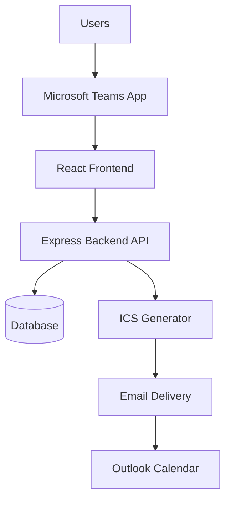

# Architecture

The application uses a layered architecture that keeps the Teams experience, business rules, persistence, and calendar delivery independently testable.

## Component responsibilities

| Component | Responsibility |
| --- | --- |
| Microsoft Teams App | Hosts the tab, provides Teams context, and initiates authentication. |
| React frontend | Renders forms, dashboards, review controls, and status feedback. |
| Express backend API | Validates input, enforces roles, controls state transitions, and coordinates delivery. |
| Database | Stores users, requests, decisions, event identifiers, and delivery outcomes. |
| ICS generator | Converts an approved request into a standards-compatible invitation. |
| Email delivery | Sends the invitation and records a provider identifier or failure. |
| Outlook Calendar | Imports the invitation for each recipient. |

## Request lifecycle

1. Teams supplies authenticated user context to the frontend.
2. The frontend acquires an API token and submits a request over HTTPS.
3. The API validates the token, role, payload, attendees, and time range.
4. The database records the request as **Pending**.
5. An admin approves or rejects it through an authorized endpoint.
6. Approval creates an ICS payload with a persistent UID and queues email delivery.
7. The delivery result updates the request to **Sent** or **Delivery failed**.

## Security and reliability

- Use Microsoft Entra ID tokens; never trust role data supplied by the browser.
- Apply authorization and input validation on every mutating API route.
- Store secrets only in the deployment platform's secret manager.
- Restrict CORS to the deployed Teams tab origin and encrypt all connections.
- Persist the ICS UID before sending and use an idempotency key for delivery.
- Retry transient provider failures with bounded exponential backoff.
- Log approval and delivery events without access tokens or invitation attachments.