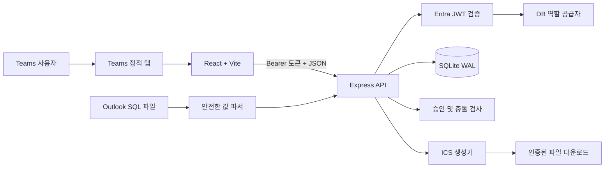
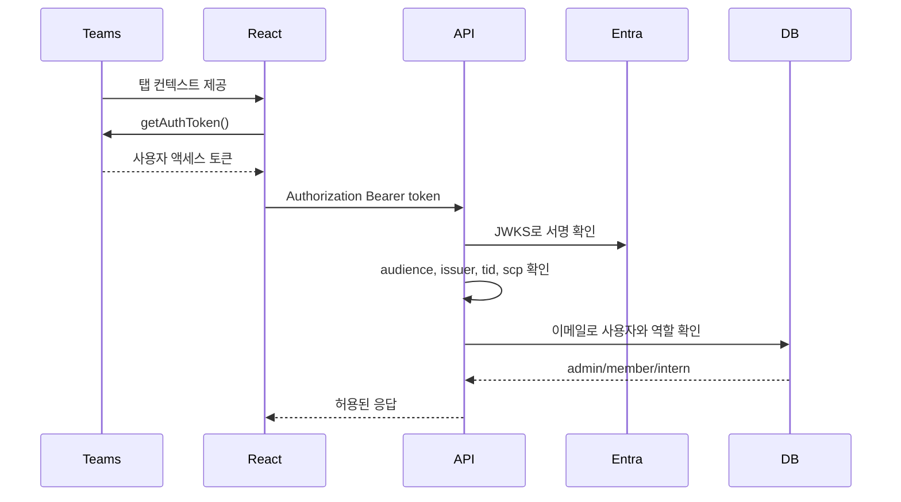

# 시스템 구조

인턴핑은 React 탭과 Express API를 하나의 Node.js 프로세스에서 제공하는 Microsoft Teams 애플리케이션입니다. 브라우저와 서버는 공용 TypeScript 타입을 사용하고 데이터는 SQLite 파일에 저장합니다.

## 구성 요소

| 계층 | 구현 | 책임 |
| --- | --- | --- |
| Teams 호스트 | Teams 정적 탭, `@microsoft/teams-js` | `/tabs/home` 로드, 테마와 SSO 토큰 제공 |
| 프런트엔드 | React, TypeScript, Vite | 캘린더, 모바일 목록, 입력창, 승인 패널, 업로드, 역할 관리 |
| 애플리케이션 호스트 | Node.js, `@microsoft/teams.apps`, ExpressAdapter | 정적 탭과 API 서버 실행 |
| API | Express 라우터 | 인증, 권한, 입력 검증, 상태 전환 |
| 저장소 | Node.js 24 `DatabaseSync`, SQLite | 사용자, 일정, 대상자와 이력 보관 |
| 외부 교환 | Outlook SQL 파서, ICS 생성기 | 기존 일정 가져오기와 캘린더 파일 생성 |

## 프런트엔드 구조

`App.tsx`가 현재 사용자, 표시 기간, 보기 방식, 일정, 사용자, 필터와 다이얼로그 상태를 관리합니다.

- `WeekGrid`: 인턴별 시간 단위 주간 보기
- `MonthCalendar`: 월간 일정 보기
- `AgendaList`: 640px 이하 모바일 날짜별 목록
- `EventDialog`: 일정 생성과 수정
- `SidePanel`: 일정 상세, 승인 대기와 처리
- `ImportDialog`: Outlook SQL 미리보기와 업로드
- `UserManagement`: 관리자용 역할 변경
- `api.ts`: Teams SSO 토큰을 포함하는 API 클라이언트

변경 후 필요한 기간의 일정을 다시 요청합니다. WebSocket이나 푸시 채널은 없으므로 다른 세션은 자동으로 갱신되지 않습니다.

## 인증 흐름

`ENTRA_TENANT_ID`와 `ENTRA_CLIENT_ID`가 모두 있으면 Entra 모드, 하나라도 없으면 개발 모드가 됩니다.

서버는 토큰 서명, audience, 발급자, 허용 테넌트와 `tid`를 확인합니다. `scp`가 없는 앱 전용 토큰은 거부합니다. 개발 모드에서는 `x-dev-user-id` 헤더로 사용자를 선택하며 인증을 수행하지 않습니다.

## API

모든 API는 Entra 모드에서 인증이 필요합니다. ICS도 인증 헤더를 포함한 `fetch`로 받은 뒤 브라우저 Blob으로 내려받습니다.

| 메서드와 경로 | 기능 |
| --- | --- |
| `GET /api/me` | 현재 사용자와 인증 모드 |
| `GET /api/users` | 사용자 목록 |
| `PATCH /api/users/:id` | 관리자 전용 역할 변경 |
| `GET /api/events?from=&to=` | 기간과 겹치는 일정 조회 |
| `GET /api/events/:id/history` | 일정 이력 조회 |
| `GET /api/events/:id/ics` | 인증된 ICS 다운로드 |
| `POST /api/events` | 일정 생성 |
| `POST /api/events/import` | Outlook SQL 일정 가져오기 |
| `PATCH /api/events/:id` | 일정 수정 |
| `POST /api/events/:id/decision` | 관리자 승인·보류·반려 |
| `DELETE /api/events/:id` | 일정 삭제 또는 본인 대상자 제외 |

일반 JSON 요청은 100KB, SQL 업로드는 4MB로 제한됩니다. 한 번에 가져올 수 있는 일정은 최대 1,000건입니다.

## 데이터 모델

SQLite는 WAL과 외래 키 검사를 활성화합니다. 로컬 기본 경로는 `data/intern-calendar.db`, Azure 기본 경로는 `/home/data/intern-calendar.db`입니다.

| 테이블 | 주요 데이터 |
| --- | --- |
| `users` | ID, 이메일, 표시 이름, 역할, 사용자 색상 |
| `events` | 일정 내용, 분류, 날짜·시간, 상태, 신청자, 주최자, 검토 정보 |
| `event_assignees` | 일정과 대상자의 다대다 연결 |
| `audit_logs` | 생성·수정·승인·보류·반려·삭제·역할 변경 이력 |

데이터베이스 접근은 준비된 문장과 값 바인딩을 사용합니다. 일정이 삭제되어도 감사 이력은 유지됩니다.

## Outlook 데이터 흐름

업로드 파서는 `INSERT INTO events (...) VALUES (...);` 형식만 읽습니다. 알 수 없는 컬럼이나 다른 SQL 문장은 무시하고 추출된 값은 서버 검증 후 준비된 문장으로 저장합니다.

같은 원본 ID가 있으면 중복으로 처리합니다. ID가 달라도 정규화한 제목·날짜·시간이 같으면 하나의 일정으로 합치고 대상자를 추가합니다.

## 운영 경계

- SQLite 파일 하나를 사용하므로 서버 인스턴스는 1개여야 합니다.
- 팀 명단은 서버 코드의 `TEAM_ROSTER`에 고정되어 있습니다.
- 날짜는 `YYYY-MM-DD` 로컬 날짜를 기준으로 처리합니다.
- 시간 일정의 ICS 기본 시간대는 `Asia/Seoul`입니다.
- 반복 일정, 실시간 동기화, 오프라인 모드와 자동 백업은 없습니다.
- Outlook Graph 동기화와 승인 알림은 구현되어 있지 않습니다.
- 사용량이 커지면 SQLite를 관리형 관계형 데이터베이스로 교체해야 합니다.