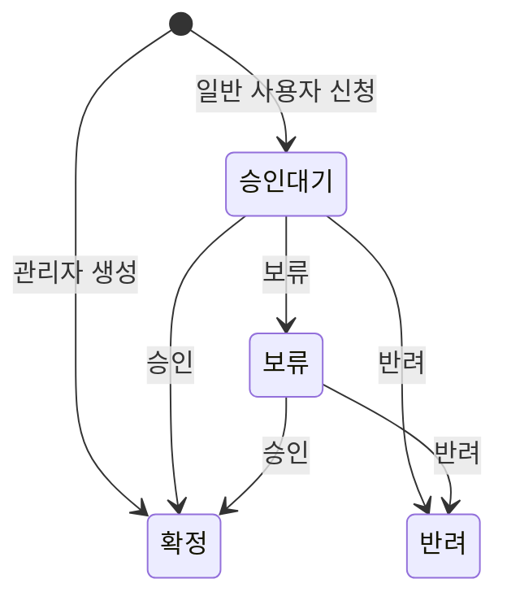

# 주요 기능

인턴핑은 팀의 인턴 투입 가능 시간을 한눈에 확인하고 투입 예약부터 관리자 승인까지 처리하는 Microsoft Teams 탭 앱입니다. 이 문서는 제공하는 기능의 범위를 설명합니다. 화면에서 조작하는 방법은 [사용자 가이드](./user-guide.md)에서 단계별로 확인하세요.

## 인턴 중심 캘린더

- **주간 보기:** 인턴별 행과 날짜별 열로 구성되어 빈 날짜를 바로 찾을 수 있습니다.
- **월간 보기:** 한 달 전체 일정과 상태를 확인합니다.
- **모바일 보기:** 화면이 좁으면 날짜별 목록과 슬라이드 상세 패널을 사용합니다.
- **필터:** 확정·승인 대기·보류·반려 상태와 대상자를 선택합니다.
- **바로 등록:** 주간 보기의 빈 칸을 선택하면 해당 대상자와 날짜가 입력된 예약 창이 열립니다.

시간 일정은 주간 화면에서 시간대에 맞춰 표시되고 빈 시간 선택은 30분 단위로 맞춰집니다.

## 투입 예약과 일정 관리

일정에는 제목, 설명, 장소, 분류, 날짜, 선택적인 시간과 한 명 이상의 대상자를 저장할 수 있습니다. 분류는 교육, 해커톤/고객사, 미팅, 업무 지원, 휴가/부재와 기타로 나뉩니다.

관리자가 만든 일정은 즉시 확정되고 그 외 사용자가 만든 일정은 승인 대기로 저장됩니다. 일반 사용자는 본인이 신청한 미확정 일정을 수정할 수 있으며 관리자는 모든 일정을 관리할 수 있습니다.

예약 입력창을 여는 순서는 [일정 추가하기](./user-guide.md#일정-추가하기)에 있습니다.

## 승인 워크플로

관리자는 승인 대기 또는 보류 일정을 **승인**, **보류**, **반려**할 수 있습니다. 처리 사유는 최대 500자까지 기록되며 신청·수정·처리·삭제 이력과 함께 보관됩니다. 검토 화면 사용법은 [일정 검토 및 승인하기](./user-guide.md#일정-검토-및-승인하기)에 있습니다.

## 중복 투입 확인

선택한 대상자가 같은 기간의 다른 **확정 일정**에 배정되어 있는지 검사합니다.

- 두 일정 중 하나라도 종일 일정이면 날짜가 겹칠 때 충돌합니다.
- 두 일정 모두 시간이 있으면 실제 시간 구간이 겹칠 때 충돌합니다.
- 승인 대기 일정끼리는 아직 확정된 배정이 아니므로 충돌 대상으로 계산하지 않습니다.

## 역할별 기능

| 기능 | 인턴 | 팀원 | 관리자 |
| --- | :---: | :---: | :---: |
| 캘린더와 일정 상세 확인 | O | O | O |
| 투입 예약 신청 | O | O | O |
| 본인의 미확정 신청 수정 | O | O | O |
| Outlook SQL 일정 업로드 | 본인 일정 | X | API에서 대상자 선택 |
| 일정 승인·보류·반려 | X | X | O |
| 모든 일정 수정·삭제 | X | X | O |
| 사용자 역할 변경 | X | X | O |

마지막 관리자는 강등할 수 없으며 `ADMIN_EMAILS`에 지정된 계정은 항상 관리자로 유지됩니다. 역할을 바꾸는 방법은 [사용자 역할 관리하기](./user-guide.md#사용자-역할-관리하기)에 있습니다.

## Outlook SQL 일정 업로드

현재 화면에서는 인턴이 본인의 기존 Outlook 일정을 가져올 수 있습니다. API는 관리자가 선택한 사용자의 일정을 가져오는 기능도 지원하지만 관리자 화면에는 업로드 버튼이 없습니다.

- 브라우저에서 제목별 미리보기와 선택 제공
- 내부 주최 일정은 기본 선택, 외부 주최 일정은 기본 제외
- 최대 파일 크기 4MB, 최대 1,000건
- 알 수 없는 분류는 기타로 변환
- 원본 ID 또는 제목·날짜·시간이 같은 일정의 중복 방지
- 여러 사용자가 같은 회의를 올리면 일정 하나에 대상자 병합

업로드된 SQL을 데이터베이스에서 실행하지 않습니다. `INSERT INTO events`의 값만 파싱한 뒤 준비된 문장으로 저장합니다.

파일 선택과 미리보기 절차는 [Outlook 일정 업로드하기](./user-guide.md#outlook-일정-업로드하기)에 있습니다.

## Outlook용 ICS 내보내기

인증된 사용자는 일정 상세에서 `.ics` 파일을 내려받을 수 있습니다. 파일에는 제목, 설명, 장소, 상태, 주최자와 대상자가 포함됩니다.

- 종일 일정은 날짜 형식으로 내보냅니다.
- 시간 일정은 기본 `Asia/Seoul` 시간대를 기준으로 UTC로 변환합니다.
- 파일명과 텍스트를 RFC 5545 형식에 맞게 정리합니다.

ICS 내보내기는 수동 방식입니다. Outlook 자동 동기화나 이메일 발송은 현재 제공하지 않습니다.

내려받는 순서는 [Outlook에 일정 추가하기](./user-guide.md#outlook에-일정-추가하기)에 있습니다.

## Teams 알림

인턴핑 패키지에는 **채팅** 탭으로 동작하는 개인 봇이 포함됩니다. 일정의 대상자에게만 개인 대화로 알림을 보내며 별도 설정은 필요하지 않습니다.

- **새 일정 배정:** 대상자로 포함된 일정이 만들어졌을 때
- **일정 변경:** 배정된 일정의 내용이 수정되었을 때
- **담당 제외:** 일정이 삭제되었거나 대상자에서 빠졌을 때

메시지에는 제목, 분류, 날짜와 시간, 처리한 사람이 담기고 배정과 변경 알림에는 ICS를 바로 내려받는 **Outlook에 추가** 링크가 함께 표시됩니다. 승인, 보류, 반려 결과는 알림으로 보내지 않습니다.

받은 알림을 확인하는 방법은 [일정 알림 받기](./user-guide.md#일정-알림-받기)에 있습니다.

## Teams 및 모바일 환경

- Teams SSO로 로그인하고 Entra 토큰을 서버에서 검증합니다.
- Teams의 기본, 다크, 고대비 테마를 반영합니다.
- 휴대폰처럼 화면이 좁으면 캘린더를 날짜별 목록으로 바꾸고 상세 내용을 슬라이드 시트로 표시합니다.
- 다이얼로그 초점 관리와 메시지 심각도 텍스트를 제공합니다.
- CSP의 `frame-ancestors`를 사용해 허용된 Teams 호스트에서만 탭을 감쌀 수 있습니다.

## 현재 제공하지 않는 기능

- Microsoft Graph 기반 Outlook 자동 동기화
- 반복 일정 생성
- 승인·반려 이메일 알림
- 실시간 화면 갱신과 오프라인 사용
- 여러 서버 인스턴스를 사용하는 확장
- 관리자 화면에서 팀 명단 자체를 추가·삭제하는 기능