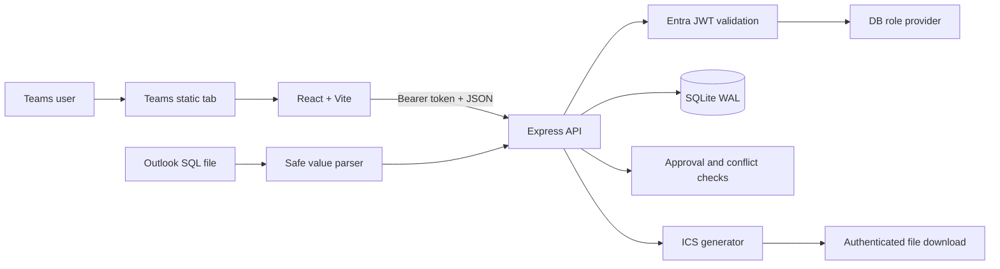
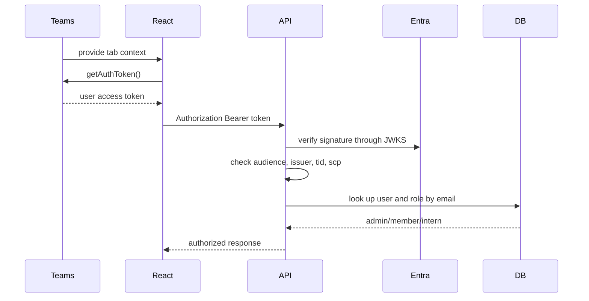

# Architecture

InternPing is a Microsoft Teams application that serves a React tab and an Express API from a single Node.js process. The browser and the server share TypeScript types, and data is stored in a SQLite file.

## Components

| Layer | Implementation | Responsibility |
| --- | --- | --- |
| Teams host | Teams static tab, `@microsoft/teams-js` | Loads `/tabs/home`, supplies the theme and the SSO token |
| Frontend | React, TypeScript, Vite | Calendar, mobile list, dialogs, approval panel, upload, role management |
| Application host | Node.js, `@microsoft/teams.apps`, ExpressAdapter | Runs the static tab and the API server |
| API | Express router | Authentication, authorization, input validation, state transitions |
| Storage | Node.js 24 `DatabaseSync`, SQLite | Users, events, assignees, and history |
| External exchange | Outlook SQL parser, ICS generator | Imports existing events and produces calendar files |

## Frontend structure

`App.tsx` owns the current user, the displayed period, the view mode, events, users, filters, and dialog state.

- `WeekGrid`: per-intern week view on an hour scale
- `MonthCalendar`: month view of events
- `AgendaList`: per-date list for screens narrower than 640px
- `EventDialog`: event creation and editing
- `SidePanel`: event details, pending items, and decisions
- `ImportDialog`: Outlook SQL preview and upload
- `UserManagement`: role changes for admins
- `api.ts`: API client that carries the Teams SSO token

After a change, the events for the current period are fetched again. There is no WebSocket or push channel, so other sessions do not refresh on their own.

## Authentication flow

When both `ENTRA_TENANT_ID` and `ENTRA_CLIENT_ID` are present the app runs in Entra mode; if either is missing it runs in development mode.

The server verifies the token signature, audience, issuer, allowed tenants, and `tid`. App-only tokens without `scp` are rejected. In development mode the user is chosen through the `x-dev-user-id` header and no authentication is performed.

## API

Every endpoint requires authentication in Entra mode. ICS is also retrieved through `fetch` with the authorization header and then downloaded as a browser Blob.

| Method and path | Purpose |
| --- | --- |
| `GET /api/me` | Current user and authentication mode |
| `GET /api/users` | List of users |
| `PATCH /api/users/:id` | Admin-only role change |
| `GET /api/events?from=&to=` | Events overlapping a period |
| `GET /api/events/:id/history` | Event history |
| `GET /api/events/:id/ics` | Authenticated ICS download |
| `POST /api/events` | Create an event |
| `POST /api/events/import` | Import Outlook SQL events |
| `PATCH /api/events/:id` | Edit an event |
| `POST /api/events/:id/decision` | Admin approve, hold, or reject |
| `DELETE /api/events/:id` | Delete an event or remove yourself as an assignee |

Regular JSON requests are limited to 100KB and SQL uploads to 4MB. A single import can carry at most 1,000 events.

## Data model

SQLite runs with WAL and foreign key checks enabled. The default path is `data/intern-calendar.db` locally and `/home/data/intern-calendar.db` on Azure.

| Table | Main data |
| --- | --- |
| `users` | ID, email, display name, role, user color |
| `events` | Event content, category, date and time, state, requester, organizer, review details |
| `event_assignees` | Many-to-many link between events and assignees |
| `audit_logs` | Create, edit, approve, hold, reject, delete, and role change history |

Database access uses prepared statements with bound values. Audit history is kept even after an event is deleted.

## Outlook data flow

The upload parser only reads statements in the form `INSERT INTO events (...) VALUES (...);`. Unknown columns and other SQL statements are ignored, and the extracted values are validated on the server before being stored through prepared statements.

An entry with a source ID that already exists is treated as a duplicate. Even when the IDs differ, entries with the same normalized title, date, and time are merged into one event and the assignees are added to it.

## Operational boundaries

- The app uses a single SQLite file, so it must run on exactly one server instance.
- The team roster is fixed in `TEAM_ROSTER` in the server code.
- Dates are handled as `YYYY-MM-DD` local dates.
- The default time zone for ICS on timed events is `Asia/Seoul`.
- There are no recurring events, live sync, offline mode, or automatic backups.
- Outlook Graph sync and approval notifications are not implemented.
- As usage grows, SQLite has to be replaced with a managed relational database.
