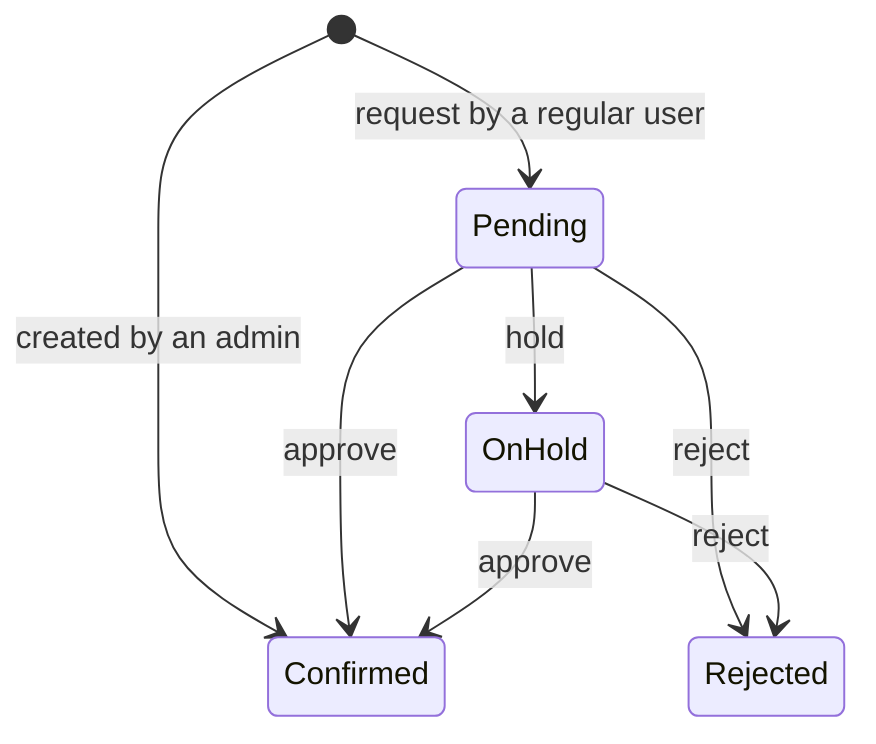

# Features

InternPing is a Microsoft Teams tab app that shows when interns are available and carries an assignment from the initial request through admin approval. This page describes what the app can do. For step-by-step instructions on the screen, see the [User guide](./user-guide.md).

## Intern-centric calendar

- **Week view:** one row per intern and one column per date, so open days are easy to spot.
- **Month view:** the whole month of events and their states.
- **Mobile view:** on screens narrower than 640px, a per-date list with a sliding detail panel.
- **Filters:** pick confirmed, pending, on hold, or rejected states, along with specific people.
- **Quick create:** selecting an empty cell in the week view opens the request dialog with that person and date filled in.

Timed events are placed against the hour scale in the week view, and empty-slot selection snaps to 30 minutes.

## Assignment requests and event management

An event stores a title, description, location, category, date, an optional time, and one or more assignees. Categories are training, hackathon/customer, meeting, work support, leave/absence, and other.

Events created by an admin are confirmed immediately; events created by anyone else are saved as pending approval. Regular users can edit their own unconfirmed requests, and admins can manage every event.

The steps for opening the request dialog are in [Add an event](./user-guide.md#add-an-event).

## Approval workflow

Admins can **approve**, **hold**, or **reject** events that are pending or on hold. The decision reason is stored with up to 500 characters and kept alongside the request, edit, decision, and deletion history. How to use the review screen is described in [Review and approve events](./user-guide.md#review-and-approve-events).

## Double-booking checks

The app checks whether the selected people are already assigned to another **confirmed event** in the same period.

- If either event is all-day, overlapping dates count as a conflict.
- If both events have times, they conflict when the actual time ranges overlap.
- Two pending events never conflict with each other, because neither is a confirmed assignment yet.

## What each role can do

| Capability | Intern | Member | Admin |
| --- | :---: | :---: | :---: |
| View the calendar and event details | Yes | Yes | Yes |
| Request an assignment | Yes | Yes | Yes |
| Edit your own unconfirmed request | Yes | Yes | Yes |
| Upload Outlook SQL events | Own events | No | Choose people through the API |
| Approve, hold, reject events | No | No | Yes |
| Edit and delete any event | No | No | Yes |
| Change user roles | No | No | Yes |

The last remaining admin cannot be demoted, and accounts listed in `ADMIN_EMAILS` always stay admins. How to change a role is described in [Manage user roles](./user-guide.md#manage-user-roles).

## Outlook SQL event upload

On the current screens, interns can import their own existing Outlook events. The API also supports importing events for a user chosen by an admin, but there is no upload button on the admin screens.

- Preview and select by title in the browser
- Internally organized events are selected by default; externally organized ones are excluded by default
- Up to 4MB per file and up to 1,000 entries
- Unknown categories are converted to "other"
- Duplicates are prevented by source ID, or by matching title, date, and time
- When several people upload the same meeting, the assignees are merged into a single event

The uploaded SQL is never executed against the database. Only the values in `INSERT INTO events` are parsed and then stored through prepared statements.

The file selection and preview steps are in [Upload Outlook events](./user-guide.md#upload-outlook-events).

## ICS export for Outlook

Authenticated users can download an `.ics` file from the event details. The file contains the title, description, location, state, organizer, and assignees.

- All-day events are exported in date form.
- Timed events are converted to UTC based on the default `Asia/Seoul` time zone.
- File names and text are normalized to RFC 5545.

ICS export is manual. Automatic Outlook sync, email delivery, and Teams notifications are not provided.

The download steps are in [Add an event to Outlook](./user-guide.md#add-an-event-to-outlook).

## Teams and mobile behavior

- Sign-in goes through Teams SSO, and the Entra token is validated on the server.
- The Teams default, dark, and high contrast themes are applied.
- On screens narrower than 640px, the calendar becomes a per-date list and details open in a sliding sheet.
- Dialogs manage focus and messages carry severity text.
- `frame-ancestors` in the CSP limits which Teams hosts may frame the tab.

## Not available today

- Automatic Outlook sync through Microsoft Graph
- Recurring events
- Email or Adaptive Card notifications for approvals and rejections
- Live screen updates and offline use
- Scaling across multiple server instances
- Adding or removing the team roster itself from the admin screens
